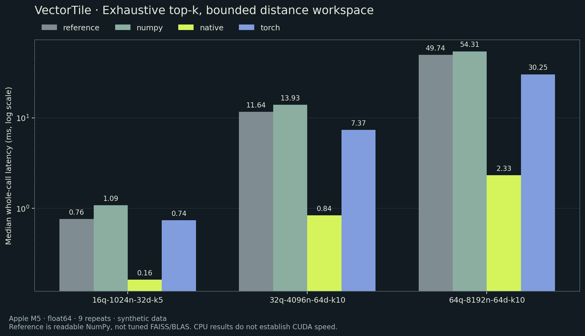

# VectorTile

**Every vector. Less workspace.** A C++17 and Python lab for exhaustive top-k
nearest-neighbor search, with deterministic ties, bounded distance workspace,
and measurements you can reproduce.

[](https://github.com/Simonn777/VectorTile/actions/workflows/ci.yml)
[](LICENSE)

**[Interactive demo →](https://simonn777.github.io/VectorTile/)** ·
[Design decisions](docs/DESIGN.md) ·
[Raw measurements](benchmarks/results/apple-m5-cpu.json) ·
[C++ implementation](native/src/vectortile.cpp)

## The engineering question

How do you retrieve the exact nearest neighbors without allocating every
query-to-corpus distance at once—and prove that the answer stays correct?

VectorTile compares a readable dense reference, tiled NumPy, a streaming
multithreaded C++ engine, and optional PyTorch CPU/CUDA backends behind one API.
It is a small systems project, not a vector database or a new retrieval algorithm.

| Implementation | Selection strategy | Principal distance / heap workspace |
| --- | --- | --- |
| Dense reference | Full lexicographic sort | Q×N×D differences + Q×N distances |
| NumPy | Tile-local top-k, deterministic merge | Two Bq×Bc float64 buffers |
| C++17 | Size-k max heap per worker | T×k candidates; no distance matrix |
| PyTorch CPU / CUDA | Stable tile sort and merge | Bq×Bc×D difference tensor + tile/sort scratch |

Q = queries; N = corpus rows; D = dimensions; Bq/Bc = tile sizes; T = workers.
These are **principal workspace terms, not total RSS**. Inputs, outputs,
validation masks, conversions and selection scratch also consume memory.
See the [complete accounting](docs/BACKENDS.md).

## Quickstart

Requires Python 3.9+. The native build supports macOS and Linux with Clang or GCC.

```sh
git clone https://github.com/Simonn777/VectorTile.git
cd VectorTile
python3 -m venv .venv
source .venv/bin/activate
python -m pip install -e '.[dev]'
python scripts/build_native.py
python -m pytest -q
python scripts/benchmark.py --quick
```

The default NumPy backend works without a C++ compiler. Optional PyTorch:

```sh
python -m pip install -e '.[torch]'
python scripts/benchmark.py --backends reference numpy native torch
```

```python
import numpy as np
from vectortile import search

corpus = np.array([[1., 0.], [0., 1.], [0., 0.], [3., 4.]])
queries = np.array([[0., 0.]])

result = search(queries, corpus, k=3, backend="native", threads=4)
print(result.indices)    # [[2 0 1]] — equal distances use smaller corpus ID
print(result.distances)  # [[0. 1. 1.]] — squared Euclidean distances
```

The Python wheel contains the Python package only. For native use outside a
checkout, build the shared library separately and set `VECTORTILE_NATIVE_LIB`.
There is no hidden compilation, download, or backend fallback on import.

## Measured result



On the recorded **Apple M5 CPU** run, 64 queries × 8,192 vectors × 64 dimensions,
k=10, the C++ backend with four requested threads took **2.326 ms median**;
the readable dense NumPy reference took **49.744 ms**. Both agreed with the
independent oracle on every repeat. This is one synthetic workload on one
machine, not a comparison against tuned FAISS, BLAS or a GPU implementation.

The tiled NumPy backend took **54.311 ms** on that same case. Its benefit here
is bounded distance workspace, not faster execution: its two 16×256 float64
buffers total **64 KiB**, compared with **4 MiB** for a full 64×8,192 distance
matrix alone. This does not establish a 64× reduction in total process memory.

The report records all nine samples per configuration, p50/p95, two warmups,
seeds, versions, hardware, native compiler flags and source hashes.
[Protocol and limitations →](docs/BENCHMARKS.md)

## Correctness before speed

- Independent scalar oracle using `math.fsum`, randomized fixtures and
  exact-index checks for separated data and deliberate ties.
- Duplicate vectors, ties across tile boundaries, k=N, tiles smaller than k,
  empty queries, strided inputs, malformed dimensions and nonfinite inputs.
- Overflow is rejected even when the offending candidate is outside top k.
- Checked C ABI, pointer-range/overlap guards, thread joining, and exceptions
  converted to status codes; [native details](native/README.md).
- C++ AddressSanitizer/UndefinedBehaviorSanitizer smoke harness, macOS/Linux
  CI, optional PyTorch CPU tests, and browser algorithm tests.

“Exact” means every pair is considered, not exact real arithmetic. Distances
use direct float64 squared differences. Reduction order can change nearly tied
rankings across backends; deterministic ties refer to equal computed distances.

## GPU status

`backend="cuda"` requires a CUDA-enabled PyTorch installation and actual CUDA
hardware. It uses the same contract and returns CPU results synchronously.
The local machine has no CUDA device, so CUDA tests are **skipped**, not passed.
No NVIDIA GPU latency, throughput, memory result, or CUDA-kernel optimization
is claimed. [Profiling directions](docs/DESIGN.md#what-to-build-next)

## Explore the repository

```text
src/vectortile/          shared API, NumPy/PyTorch backends, ctypes bridge
native/                 C++17 implementation, C ABI, sanitizer harness
tests/                  independent-oracle and boundary-case tests
scripts/                explicit native build, benchmark, chart generation
benchmarks/results/     raw measured evidence with environment metadata
site/                   accessible, dependency-free algorithm explainer
docs/                   design choices, numerical limits and provenance
```

To run the browser explanation locally:

```sh
node --test tests/demo.test.mjs
python -m http.server 8000 --directory site
```

Open `http://localhost:8000`. The browser uses its own small JavaScript
implementation to explain the algorithm; its animation is not a C++ benchmark.

Created in October 2026 with substantial AI-assisted implementation and review.
[Development provenance](docs/DEVELOPMENT.md) · [MIT license](LICENSE)
